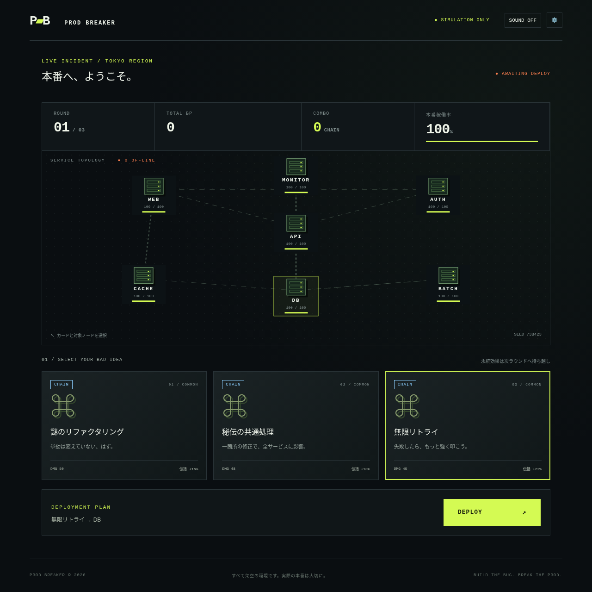

# PROD BREAKER — SURVIVOR

**BUILD THE BUG. BREAK THE PROD.**

暴走バグを操作し、架空のデータセンターを連鎖爆破する90秒・3分・5分・最大30分のENDLESSから選べるサバイバーゲーム。v2でターン制カード配置からリアルタイムの移動・自動攻撃・成長へ変更しました。

主人公の暴走バグが、ホーム画面でもプレイヤーを迎えます。

**プレイ:** https://prod-breaker.vercel.app/

**ソース:** https://github.com/SSsan-00/prod-breaker

ゲーム中の破壊対象はすべて架空の環境です。共有スコアボードは、プレイ終了時の名前とスコアをNeonのデータベースに保存します。



## 遊び方

- **PC:** WASD / 矢印キーで移動。攻撃は近くのサーバー・敵へ自動発射。
- **スマホ:** ゲーム画面をドラッグ。触れた位置を起点とした仮想スティックで移動。
- **成長:** サーバーや敵が落とす青い「障害ログ」を拾うとレベルアップ。130種類から提示される3択で強化を選びます。選択中は一時停止。次のレベルに必要な障害ログは最大500。
- **連鎖:** サーバーや敵を破壊すると周囲へ障害が伝播。範囲・ダメージ・貫通・同時発射・持続攻撃などを組み合わせて大連鎖を作ります。
- **PANIC:** 画面下のボタン / Spaceで「緊急マージ」。周囲に100ダメージ（SRE COREにはさらに最大HPの5%）を与え、ログを全回収し、1.5秒無敵。22秒のクールダウンは連鎖の節目で短縮します。
- **OVERDRIVE:** 10・30・100・300・1,000・3,000・10,000連鎖で発動・延長。攻撃間隔が短縮し、ダメージが連鎖数に応じて25〜65%増加します。
- **生存:** WAFドローンや復旧BOTを避けて選択した時間の生存を目指します。30秒ごとにウェーブが進み、大型SRE COREが登場。
- **一時停止:** Ⅱ / Esc。非表示タブ・ウィンドウのフォーカス喪失時も自動停止。再開ボタンで戻ります。
- **結果:** 生存時間、BP、最大連鎖、破壊台数、称号、ジョーク障害報告書。称号・発生原因・再発防止策はプレイ内容とシードに応じて変化。1タップ再挑戦。

選択した時間はゲーム内の進行時間です。レベルアップ選択・一時停止の時間は含めません。HPがなくなると選択時間より早く終了します。

## 強化と進化

| 強化                 | 効果                    |
| -------------------- | ----------------------- |
| WHERE句行方不明      | 貫通 +1、ダメージ +6    |
| DB接続リーク         | 近距離の持続ダメージ +9 |
| キャッシュ不整合     | 同時発射 +1             |
| 無限リトライ         | 爆発伝播範囲 +35        |
| 秘伝の共通処理       | 連鎖ダメージ +12        |
| 金曜17:59            | BP倍率 +35%             |
| テスト未実施         | 攻撃間隔15%短縮         |
| ログ出しすぎ         | ログ回収範囲 +65        |
| 私の環境では動く     | 最大HP +25、HP35回復    |
| 監視停止             | 敵移動速度12%低下       |
| 謎のリファクタリング | 弾ダメージ +14          |
| 環境変数整理         | 移動速度 +15%           |

上記に加え、N+1クエリ、SELECT *、キャッシュ全消し、force push、深夜のホットフィックスなど全130種類。特定の組み合わせでリトライストームなど65種類の進化が一度ずつ発動します。重複取得で効果を蓄積します。攻撃頻度・移動速度などには上限があり、上限を超えた強化分は攻撃力へ変換します。

進化の組み合わせは強化カードに表示されます。一度成立した進化はそのプレイ中に重複発動しません。

- 無限リトライ＋タイムアウト延長 → **リトライストーム**：連鎖範囲・ダメージ増加
- N+1クエリ＋DB接続リーク → **コネクション枯渇祭り**：同時発射・持続ダメージ増加
- 深夜のホットフィックス＋金曜17:59 → **週末リリース**：攻撃速度・BP倍率増加
- 監視閾値の引き上げ＋キャッシュ全消し → **完全に正常**：敵を減速し、持続ダメージ増加
- SELECT *＋WHERE句行方不明 → **全件フルスキャン**：貫通・連鎖範囲増加
- force push＋設定ファイル直編集 → **本番直編集**：攻撃力・移動速度増加
- オンコール当番＋ロールバック失敗 → **真夜中の復旧会議**：全回復・最大HP・連鎖強化
- 仕様です＋私の環境では動く → **動くから仕様**：全回復・最大HP・持続ダメージ増加

- cron多重起動＋バッチの手動再実行 → **二重起動フェスティバル**：持続・連鎖ダメージ増加
- 無停止マイグレーション＋インデックス貼り忘れ → **ロック待ちの行列**：貫通・連鎖範囲増加
- フラグ全部ON＋カナリア全量配信 → **全員カナリア**：同時発射・攻撃速度増加
- 証明書の期限切れ＋時刻同期ずれ → **期限切れタイムリープ**：持続ダメージ増加・敵減速
- 承認待ちのまま緊急リリース＋レビューコメント全解決 → **承認済みということにする**：全回復・最大HP・攻撃力増加
- オートスケール暴走＋クォータ上限到達 → **無限スケール上限**：同時発射・持続ダメージ増加
- スキーマ変更直当て＋API仕様の暗黙変更 → **互換性は来世で**：貫通・攻撃力増加
- 障害対応会議＋とりあえず再起動 → **再起動の承認会議**：全回復・最大HP・持続ダメージ増加
- 検証環境だけ最新＋構成管理のドリフト → **環境差分パラダイス**：連鎖範囲・BP倍率増加


スマホのホーム画面とプレイ画面は縦スクロールせず、長押しによる選択メニューを抑制します。ホーム画面では90秒、3分、5分、最大30分のENDLESSを選択できます。ENDLESSも他のモードと同じWAVEごとの敵強化・出現数で進行し、30分生き延びるとクリアです。ハイスコアはモード別です。

## 設定

初期ミュート。SOUND ONで自作Web AudioのBGM・SEを有効化。音量・演出軽減を変更できます。OSのreduced motion設定にも対応。演出軽減でCanvas粒子・画面揺れ・ダメージ点滅を停止します。

設定とv2ハイスコアをlocalStorageに保存します。保存不可でもプレイ可能。旧版とはスコア体系が異なるため、サバイバーのハイスコアは別保存です。

## 開発と検証

Node.js 24 / npm。

```sh
npm ci
npm run dev
```

http://localhost:3000 を開きます。`?seed=42`のようにシードを指定すると、同じ入力タイミング・同じ強化選択で再現できます。

```sh
npm run lint
npm run typecheck
npm test
npm run build
npx playwright install --with-deps chromium
npm run test:e2e
```

E2Eは本番ビルドを`next start`で起動して検証します。3000番ポートは他のサーバーを停止して空けてください。検証記録・既知の制限は[QA.md](QA.md)。

v2.22.3の処理時間計測と変更前後の挙動・描画比較は[パフォーマンス検証](docs/performance.md)を参照してください。

## 構成

Next.js App Router / React / TypeScript strict / Tailwind CSS / Motion / Canvas 2D / Web Audio / Vitest / Testing Library / Playwright / ESLint / GitHub Actions / Vercel。依存関係をpackage-lock.jsonで固定。DB・認証・有料API不要。

- `src/game/survivor.ts`: ブラウザから独立した純粋な固定ステップ判定。シードPRNG・移動・射撃・敵・復旧・ログ・成長・FIFO爆発伝播・勝敗。
- `src/components/Arena.tsx`: カメラ追従・ピクセル描画・電撃・爆発・レーダー・仮想スティック。requestAnimationFrameとCanvas。
- `src/components/Game.tsx`: 入力、固定30更新/秒の進行、HUD、強化選択、一時停止、設定、リザルト。
- `src/effects/audio.ts`: 自作BGM・効果音。音声障害時もゲームは継続。
- `src/lib/storage.ts`: 保存が拒否された場合のフォールバック。
- `tests/`: 固定シード・入力・強化・終了・上限の単体テスト、PC/スマホ相当のブラウザE2E。

描画フレーム数は判定に使いません。各更新は1/30秒。非表示タブでは判定・描画を止めます。低FPSでは最大0.2秒分を追いつく方式で、処理落ち時に突然ダメージを受ける長時間の巻き戻しは行いません。1連鎖200イベント、対象あたり2回、敵100体・弾120発・ログ160個・演出100個で負荷を制限します。

## 公開

VercelにGitHubのmainを連携済み。mainへのpushで自動デプロイします。Next.js自動設定、`npm run build`、環境変数不要。無料Hobbyプランで動作可能。公開URLの版更新を確認してからリリース完了と扱います。

## ライセンス

[MIT](LICENSE)。画像・音声はコードから生成したオリジナル表現です。

本番環境は壊れる。でもコンボは止まらない。

### バランス確認

Node.js 24で `node scripts/balance.mjs` を実行すると、90秒・3分・5分の固定シードで2種類の自動操作をシミュレーションし、結果と各WAVEのSRE COREの生存時間を出力します。自動操作による目安であり、人のプレイを再現するものではありません。`node scripts/endless-balance.mjs` はプレイヤー無敵の固定入力でENDLESSの30分まで成長と敵の数を記録します。無敵のため生存難易度の評価には使えません。

## 共有スコアボード（Neon）

ホームの「RANK」から名前とモード別ランキングを確認できます。プレイ終了時に名前とスコアが自動で公開されます。通信に失敗した場合は、次回のアクセスや再接続時に再送します。名前は端末内に保存され、初回はランダムに付与されます。リザルトの「名前変更 / ランキング」から変更すると、今回のスコアにも反映されます。認証やスコアのサーバー側検証はなく、名前のなりすましや不正なスコアを防ぐものではありません。個人情報を名前に入力しないでください。

NeonでPostgresデータベースを用意し、Neon SQL Editorで `db/leaderboard.sql` を実行してください。Vercelのプロジェクト設定に接続文字列を `DATABASE_URL` として登録し、再デプロイします。ローカル開発では `.env.local` に同じ環境変数を設定します。接続文字列をGitやチャットに載せないでください。未設定または接続障害時はランキング画面にエラーを表示し、ゲーム自体はプレイできます。
